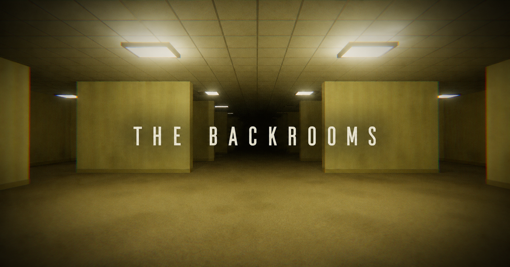

  

<h1 align="center">THE BACKROOMS</h1>

<strong>you noclipped out of reality</strong>

  <strong><a href="https://backrooms.4oli.com/">Play now at backrooms.4oli.com</a></strong> 
  runs in your browser — no account, no download, no ads.

A first-person survival-horror game set in the Backrooms. You fall out of
reality into an endless yellow maze, and the only way out is down: six levels,
each with its own dangers and its own way to the next one.

## The game

- **Six levels to descend**, from the lobby to the last run, each one endless in
  every direction.
- **Survival matters**: thirst, oxygen, health, torch charge, carried water, and
  a weight-limited inventory.
- **Scavenge what you need**: a metal pipe, a pipe wrench, a kitchen knife, a
  fire extinguisher, a pistol with limited ammunition, batteries, and bottles.
- **Five entities**, each with its own behaviour — some keep to unlit rooms,
  some hunt in packs, and one is very tall and very patient.
- **Escape**: collect three fuses, power the exit portal, and get out. Leaving
  early is possible, if you dare.
- **Your run is saved in your browser**: resume from a checkpoint and keep your
  local completion records. Dying clears the checkpoint.
- **Deterministic worlds**: share a link with `?seed=1234` and everyone plays
  the same maze.
- **Desktop and touch**: keyboard and mouse on a computer, on-screen controls on
  phones and tablets.

Headphones are strongly recommended.

## Controls

| Input | Action |
| --- | --- |
| `WASD` + mouse | Move and look |
| Arrow keys | Turn and tilt, for touchpads and anyone without a mouse |
| `Shift` | Sprint |
| `Space` / `C` | Jump or swim up / crouch or swim down |
| `E` | Interact, pick up, or use the current objective |
| `LMB` / `RMB` | Attack / block, aim, or drink depending on the item |
| `Tab` / `I` | Inventory |
| `F` / `R` / `G` | Torch / receiver / drop |
| `Esc` | Pause and save a checkpoint |

On phones and tablets the game switches to on-screen controls: the left thumb
steers, the right thumb looks, and labelled buttons cover everything in your
hands.

## Bugs, ideas, and feedback

This repository is the game's public home. If you got stuck, found a bug, or
thought of something that would make the descent better, tell us:

- **Found a bug?** [Report it](https://github.com/martinezharo/backrooms/issues/new?template=bug.yml) — saying which level you were on and what you were doing helps a lot.
- **Have an idea?** [Suggest it](https://github.com/martinezharo/backrooms/issues/new?template=suggestion.yml).
- **Anything else?** [Open an issue](https://github.com/martinezharo/backrooms/issues/new) and tell us.

The source code is not public. This repository exists for the community: bug
reports, suggestions, and announcements about the game.

## Credits

Audio, models, and fonts are third-party assets with their own attributions —
see [CREDITS.md](CREDITS.md).

## Links

- **Play The Backrooms**: <https://backrooms.4oli.com/>
